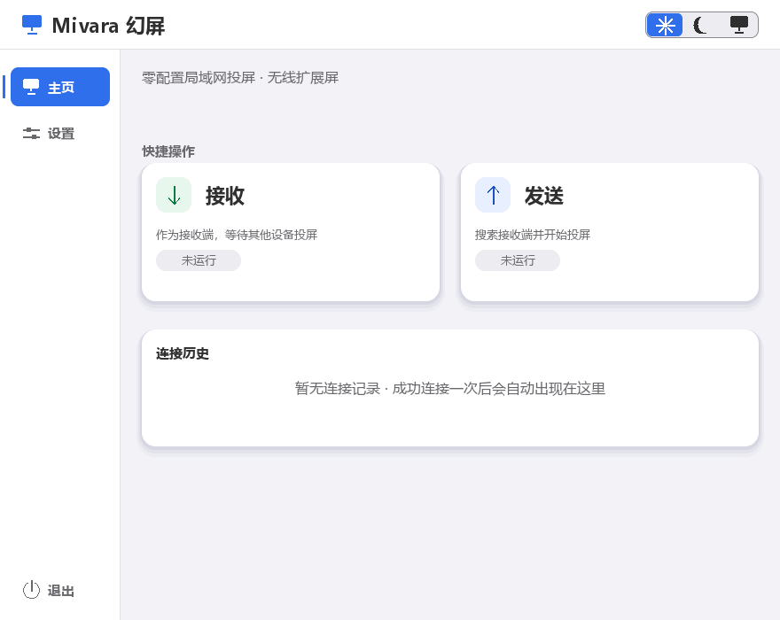
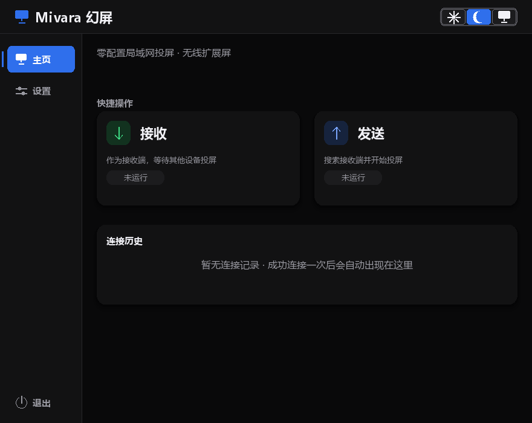
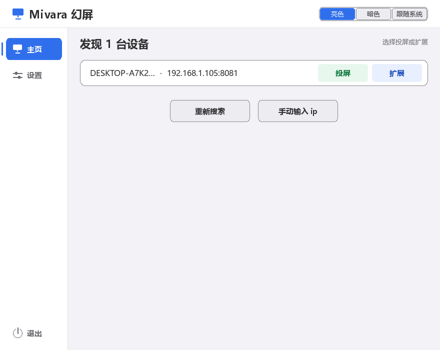
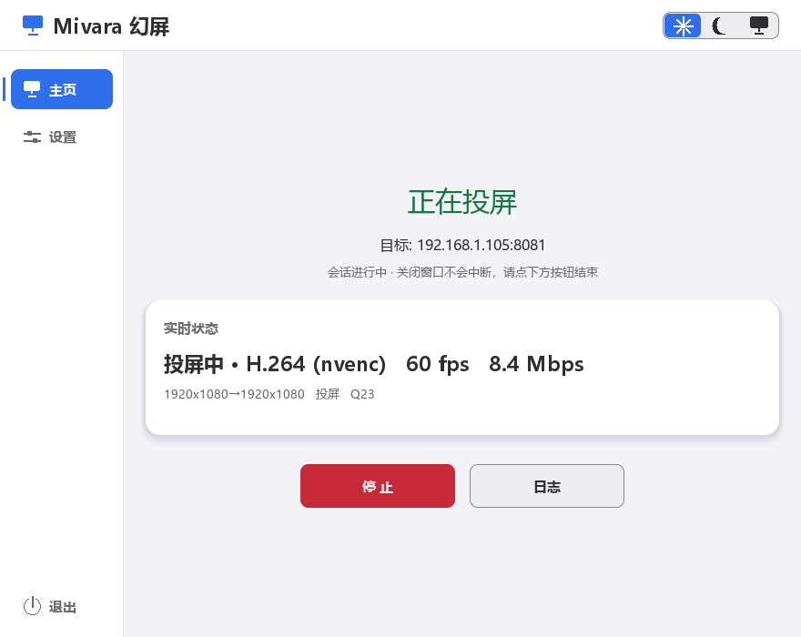

# User Guide

> [Docs index](../README.md) · [Back to README](../../README_EN.md) · [中文](../zh/usage.md)

Mivara is a lightweight, cross-platform **screen extension / casting** tool. The sender captures the local screen and streams it over the network to the receiver, which displays it fullscreen.

Two modes are provided:

1. **Mirror** — the receiver shows the sender's primary screen in full (demos and presentations).
2. **Extend** — the sender **automatically activates a virtual display**, creating a real desktop workspace; windows and the mouse can be dragged into this "invisible screen" and the receiver shows it in real time. The virtual display is detached when the session ends.

Extend mode requires a Windows indirect display driver (IddCx); see [Virtual Display Driver](virtual-display.md) for installation. The driver only needs to be installed once — attaching/detaching the virtual display is managed automatically during the session.

This page covers day-to-day use: the interface and capabilities first, then connecting by display mode. For discovery, handshakes and streaming internals, see [Architecture & Protocol](architecture.md).

## Screenshots

The GUI is Chinese-only; the screenshots below show the Home screen (light/dark), device discovery, and an active stream:

| Home (light) | Home (dark) |
|:---:|:---:|
|  |  |

| Device discovery | Streaming |
|:---:|:---:|
|  |  |

## Features

| Category | Capability |
|----------|-----------|
| **Extend mode** | Virtual display auto-enabled and attached at session start. On Windows (MttVDD) every exit path (normal end / Ctrl+C / disconnect / console close / hard-kill fallback) detaches it and disables the device. On Linux, extend enables an xrandr `VIRTUAL*` connector or a Sway / Hyprland headless output and removes what this session created. macOS has no such path |
| **Virtual display integration** | On Windows, activation/deactivation/positioning is done in-process via the CCD API. On Linux, xrandr / swaymsg / hyprctl enable the output and capture is limited to that rectangle |
| **Video codecs** | H.264 / H.265 / AV1 (FFmpeg), hardware-first (NVENC/QSV/AMF/VAAPI) with automatic software fallback (libx264/libx265/SVT-AV1); raw/RLE lossless options kept |
| **Live reconfigure** | Change codec/quality/bitrate/fps/scale/chroma mid-session — applied in seconds without dropping the stream (codec switches blip for a frame or two) |
| **Visible cursor** | Windows (GDI) and Linux X11 (XFixes) draw the pointer into the video frames; on Linux Wayland the compositor draws the cursor into the portal stream; macOS capture does not composite a cursor yet. Pointer crossing in extend mode is Windows-only |
| **Direct connect** | `sender <IP>` skips discovery — works when SSDP multicast is blocked by network policy |
| **Discovery** | Zero-config SSDP discovery (UDP 1900 multicast + broadcast fallback), shows hostnames |
| **Connection history** | Last 20 connections embedded on the Home screen — one-click direct connect, no search needed |
| **GUI** | SDL2_ttf interface: left nav (Home / Settings), receive/send, connection history, automatic search, device list (cast; Extend is disabled on macOS, and on Linux it tries a virtual output), manual IP entry, live status panel, independent log window |
| **Auto-start / auto-receive** | Launch at logon (Windows Task Scheduler, no UAC prompt; Linux writes `~/.config/autostart/mivara.desktop`); auto-receive opens the app directly in receive mode when enabled (off by default) |
| **Update check** | A "Check for updates" button in Settings plus an automatic check at launch (on by default, at most once per 24 h per machine, can be turned off). A new release can be downloaded in-app (size + SHA-256 verified) and installed with one click, or opened on the release page for a manual download. Only the GitHub release source is contacted; no local data is uploaded |
| **Performance** | Up to 120 FPS streaming, 4 MB socket buffers, TCP_NODELAY |
| **CPU offload** | RLE frame compression and color conversion offloaded to the receiver's CPU (TCP 8082, RLE mode only) |
| **Port inspector** | Remotely list/query/kill processes on any port of the receiver (TCP 8083) |
| **Cross-platform** | Linux (X11, plus Wayland portal capture), Windows 10/11, macOS 10.15+ |

For the protocol and implementation behind each capability, see [Architecture & Protocol](architecture.md).

## Display Modes

| Mode | GUI button / CLI | Behavior |
|------|------------------|----------|
| Mirror | "Cast" / `--mode mirror` (default) | Receiver shows the sender's primary screen in a resizable window |
| Extend | "Extend" / `--mode extend` | Sender auto-activates a virtual display; receiver shows it borderless fullscreen as a **real desktop workspace** — windows can be dragged in, the mouse crosses over |

> Earlier "simulated extend" variants (extend-right/below/left: fullscreen mirror with a blue seam line) were removed — they never created a real desktop workspace. Extend always uses `--mode extend` (protocol mode 1).

> **Platforms**: on macOS the Extend chip stays greyed out; a click only explains that it is unavailable, and `sender --mode extend` fails before discovery (`extend_unsupported`). On Linux, Extend tries to enable a real second output: a disconnected `VIRTUAL*` connector (or `MIVARA_VDD_OUTPUT`) under X11, Sway's `create_output`, or a Hyprland headless output. If that fails the process exits 1 with `vdd_unavailable` and does not send the primary screen as mode=1. GNOME on Wayland has no userspace virtual monitor; install a kernel virtual display yourself (evdi, for example) and Mivara will use it once xrandr lists a `VIRTUAL` connector. Wayland capture uses xdg-desktop-portal + PipeWire (a screen-share dialog; the compositor draws the cursor). If the portal fails, capture falls back to X11/XWayland and says so in the log. If neither works the sender reports `capture_unavailable` and does not stream black frames.

On Windows, extend relies on the indirect display driver; installation and resolution configuration are covered in [Virtual Display Driver](virtual-display.md). The Linux outputs that can be enabled, the environment variables, and what is still missing are on that same page.

## GUI

Launching the GUI is recommended:

```
bin/app
```

The top-right of the header holds the **appearance switcher** — three icons: sun = Light, moon = Dark, monitor = Follow system. The left side holds the nav bar: **Home** (receive/send + connection history) and **Settings**:

- **Appearance**: three icons in the header (sun = Light, moon = Dark, monitor = Follow system); one click recolours the window and writes `theme` to `config.ini`, with no OK needed. The same setting appears as a labelled three-way switch under Settings · Appearance, for anyone who does not read the icons. For "Follow system", see the platform note in [Settings & History](#settings--history)
- **Home · Receive**: shows the local IP, ports and a "receiving" status while launching the receiver to wait for connections; "Stop" ends it
- **Home · Send**: shows "searching"; once devices are found (with hostnames), each row offers "Cast" (mirror) or "Extend" (the button is disabled on macOS; on Linux it tries a virtual output and the home screen shows the reason when that fails); streaming can be stopped at any time
- **Home · Connection history**: the last 20 connections are listed under the receive/send cards — click to connect directly (no search); delete single entries or clear all; mouse wheel scrolls
- **Home · In session**: while casting/receiving you can switch to Settings (the session keeps running); "Back to session" or ESC in Settings returns to the live status, while "Home" goes to the Home screen (shows the session running, with Stop)
- **Settings**: the left column is "Quality & codec" (codec auto/H.264/H.265/AV1/raw/RLE, quality/FPS/bitrate/scale/chroma); the right column is "Connection & startup" (hardware accel / status console / log window / auto-start / auto-receive / auto update check) and "Appearance"; the "Software update" card sits below. **Changed transfer parameters apply live when you press OK — the stream is not dropped**
- **Settings · Update**: the bottom "Update" row shows the current version and the check result; a new release offers "Download update" (with progress) → "Install now" (Windows: after verification the app quits and starts the installer; Linux/macOS: opens the release page). You can "Ignore this version"; a new release also shows a banner at the top of Home and a dot on the Settings tab
- **No devices found**: three options — "Keep searching", "Enter IP manually", "Exit"; a manually entered IP leads to the same cast/extend choice (Extend is disabled on macOS; Linux tries a virtual output). If a connection fails or no receiver is ever found, see [Troubleshooting](troubleshooting.md)
- **Streaming status**: live FPS / bitrate / encoder in the GUI status panel; the "Log" button opens the independent log window (child-process output). The cmd console is hidden by default — re-enable it in Settings
- **ESC**: discard Settings edits and return to the session; back from the manual-IP page; stop the session on cast/receive screens and go home; quits from home

On Windows you can also use the convenience scripts in `scripts/`: `start_receiver.bat` starts the receiver in one click; `启动投屏发送.bat <receiver-IP>` direct-connects and sends.

## Receiver Keys

| Key | Action |
|-----|--------|
| ESC / Q | Disconnect and quit |
| F11 | Toggle fullscreen (extend mode) |
| Close window | Stop receiving |

## Sender Keys

| Input | Action |
|-------|--------|
| Ctrl+C | Graceful exit (virtual display detached + device disabled) |
| Mode prompt 1/2 | Mirror / Extend (interactive CLI only; on macOS typing 2 explains why and stays on mirror, on Linux it continues to the resolution prompt and tries to enable a virtual output) |

## Settings & History

The GUI Settings screen (persisted to `%LOCALAPPDATA%\Mivara\config.ini`):

| Setting | Default | Description |
|---------|---------|-------------|
| Appearance | follow system | Light / Dark / Follow system; the header switcher applies instantly and writes `theme` to `config.ini`, so it needs no OK |
| Codec | H.264 | auto/H.264/H.265/AV1/raw/RLE |
| Hardware accel | on | Prefer GPU encoding |
| Quality / Bitrate | 23 / 0 | Bitrate > 0 uses bitrate mode, otherwise CRF |
| FPS / Scale | 60 / 100% | Sender cap and pre-downscale |
| Chroma | 4:2:0 | 4:4:4 = sharper text (software encode) |
| Status console | off | Shows the classic cmd window |
| Log window | off | Auto-open the independent log window |
| Auto-start | off | On Windows, registers a Task Scheduler job (onlogon, no UAC at logon) and the uninstaller removes it. On Linux, writes or deletes `$XDG_CONFIG_HOME/autostart/mivara.desktop` (`~/.config/autostart` when that variable is unset); Exec is the absolute path of the running program |
| Auto-receive | off | Enter receive mode as soon as the app opens |
| Auto update check | on | Checks for a new release ~3 s after launch (at most once per 24 h per machine); when off, only the manual button goes online |

> "Follow system" reads the OS light/dark preference and re-checks it about every 2 s. Windows reads the `AppsUseLightTheme` registry value. Linux reads GTK `settings.ini` (`gtk-application-prefer-dark-theme`, or a theme name ending in `-dark`) and KDE `kdeglobals` `ColorScheme` first; only when those files do not answer does it run `timeout 0.3 gsettings` for the GNOME `color-scheme`. macOS reads `AppleInterfaceStyle`. A failed probe always falls back to light.

**Live reconfigure**: while streaming, change any transfer parameter in Settings and press OK — it takes effect within seconds without dropping the connection (codec/scale switches blip for a frame or two). In classic console mode there is no stdin channel, so the session is restarted with the new parameters instead.

Transfer status is shown live in the GUI status panel (FPS / bitrate / encoder); the independent log window shows child-process output. The cmd console is hidden by default and can be re-enabled in Settings.

The connection-history list (`history.ini`, last 20 entries) sits under the receive/send cards on the Home screen — click to connect directly (cast, or extend on Windows / Linux) without searching; individual entries can be deleted or cleared. On macOS an old extend entry does not silently reconnect as mirror: Extend and the row body only explain that extend is unavailable. On Linux an extend entry starts extend; when the virtual output does not come up, the home screen shows why.
